# Python Summer Party Notebooks

This repository contains my completed notebooks from Interview Master's Python Summer Party challenge. It's intended for recruiters, peers, and learners to review my approach to data analysis problems using pandas and numpy.

## How to use

1. Create and activate a Python environment (venv or conda).
2. Install dependencies:
   
   pip install jupyterlab pandas numpy
   
3. Launch Jupyter Lab or Notebook and open any `day-XX.ipynb` file.

## About Interview Master

These challenges are hosted by Interview Master -- a platform for preparing for Data Science & Analytics interviews. Learn more at [interviewmaster.ai](https://www.interviewmaster.ai).